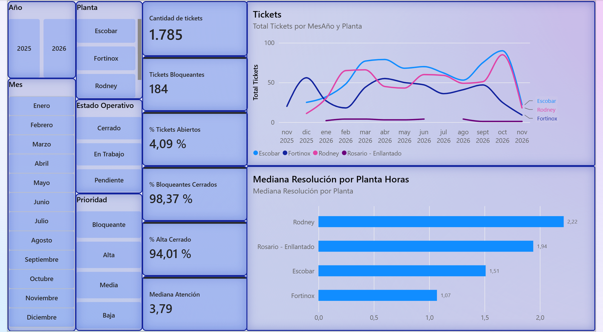
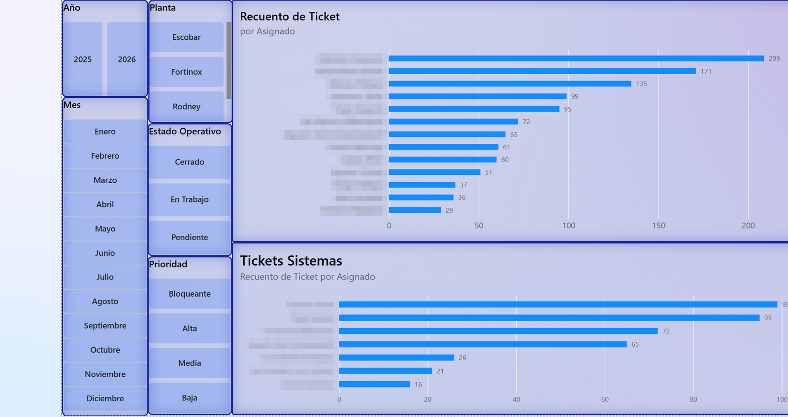
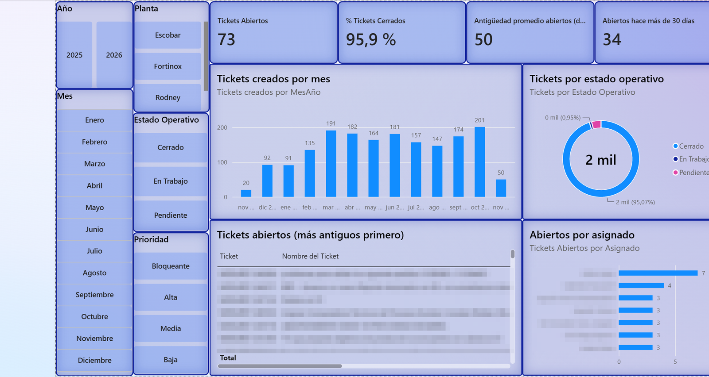
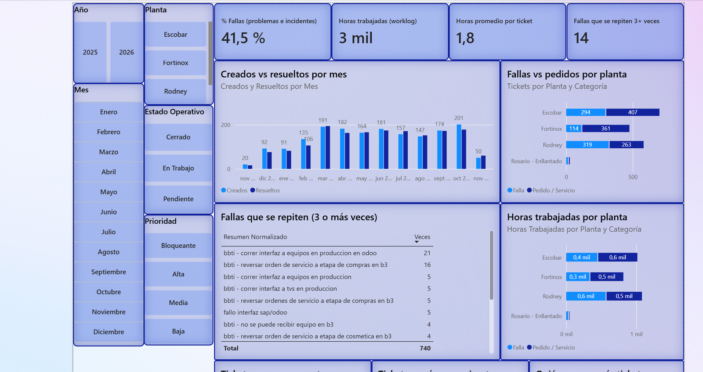
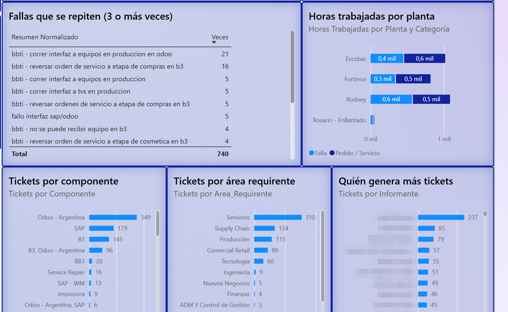

# 🖥️ IT Service Desk · Executive Dashboard (Jira)


-217346?style=for-the-badge)


> Executive dashboard for an **IT service desk** supporting several industrial plants. It pulls tickets **straight from the Jira REST API**, tracks volume, SLA, response and resolution times, and surfaces **recurring failures** so the team can fix root causes.

*The report itself (page names, measures, labels) is in Spanish.*



## 📌 Questions it answers

- How many tickets come in and get resolved each month? Is the backlog growing or shrinking?
- Are we meeting the **SLA** for first response and resolution?
- What is the **median** response and resolution time per plant?
- Which open tickets are the oldest (30+ days)?
- How much of the workload is **failures** vs. **service requests**? Which failures repeat 3 or more times?
- Which areas, components and people generate the most demand? How many hours does each plant consume?

## 🔌 Extraction: Power Query against the Jira API

The `Jira` query calls `rest/api/3/search/jql` with a **JQL** filter (project and plants) and walks through every page with `List.Generate` using `nextPageToken`:

```m
Pages =
    List.Generate(
        () => GetPage(null),
        each _ <> null,
        each if Record.Field(_, "isLast") = true
             then null
             else GetPage(Record.Field(_, "nextPageToken")),
        each _
    ),
TodasLasIssues = List.Combine(List.Transform(Pages, each [issues]))
```

Fields are then expanded (status, priority, assignee, plant, component, requesting area, response and resolution SLA, logged hours) and typed.

## 📐 DAX measures (33)

| Group | Measures |
|---|---|
| Volume | Total tickets, open / closed tickets, % open / closed, monthly average |
| Priority | High-priority tickets, blocker tickets, % high closed, % blockers closed |
| SLA | SLA met, SLA breached, **% SLA met** |
| Times | Average and **median** response and resolution time, age of open tickets, open for 30+ days |
| Monthly flow | Tickets created (month), tickets resolved (month), **monthly balance** |
| Root cause | Failures, requests, % failures, times repeated, **recurring failures** |
| Effort | Hours worked, hours per ticket |

```dax
-- Normalized titles (lowercase, no trailing period) to group repeated tickets
Fallas Recurrentes =
COUNTROWS ( FILTER ( VALUES ( Jira[Resumen Normalizado] ), [Fallas] >= 3 ) ) + 0
```

- **Created vs. resolved** are compared over a disconnected `Meses` table using `TREATAS`, so each measure filters by its own date (created or resolved).
- `Estado Operativo` groups Jira statuses into *Open / In progress / Closed*.
- `Categoría` separates **Failure** (Problem, Incident) from **Request / Service**.

## 📄 Report pages

1. **Indicators:** main KPIs and SLA (screenshot at the top).
2. **Performance:** tickets per assignee and per team.

   
3. **Operational summary:** status, priority, backlog and oldest open tickets.

   
4. **Operational analysis:** created vs. resolved, failures vs. requests, recurring failures, hours per plant, tickets by component, area and reporter.

   
   

## 🔒 Data

The repository contains **only the model, the queries and the report design**. It includes no tickets, `.pbix` or cache, and technician names in the model were replaced with `Técnico 1…7`. In the screenshots, people's names and ticket titles are **pixelated**. Using the report requires access to a Jira instance with your own credentials.

## ▶️ How to open it

1. Open `Mesa IT - Dashboard Ejecutivo Jira.pbip` in Power BI Desktop.
2. Enter your Jira credentials (account + API token) when prompted.
3. Refresh.
